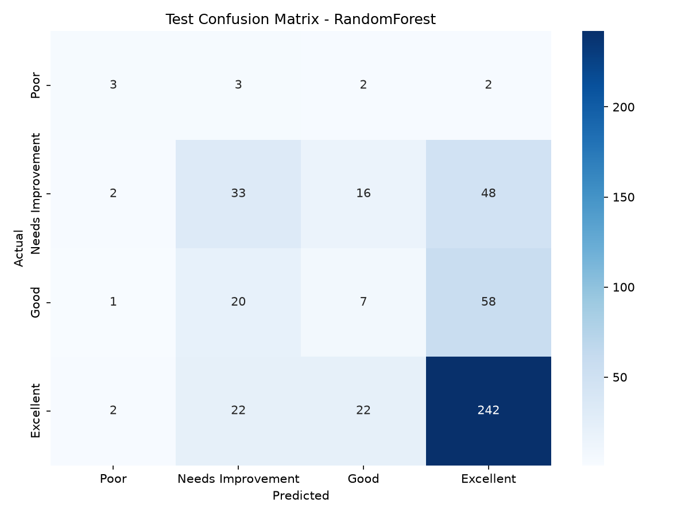
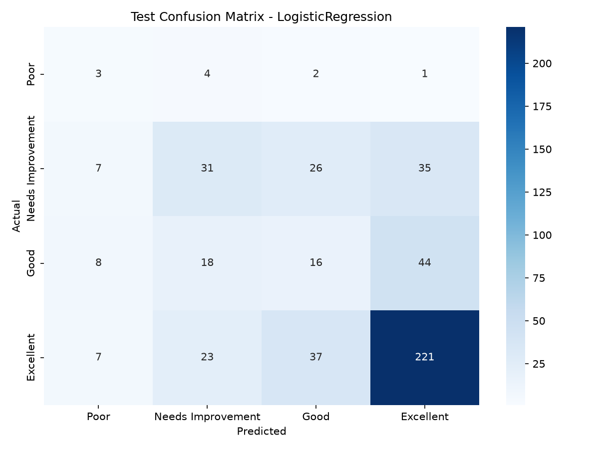
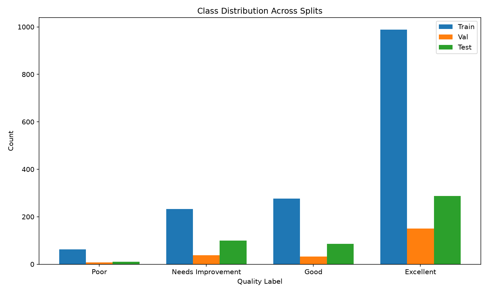
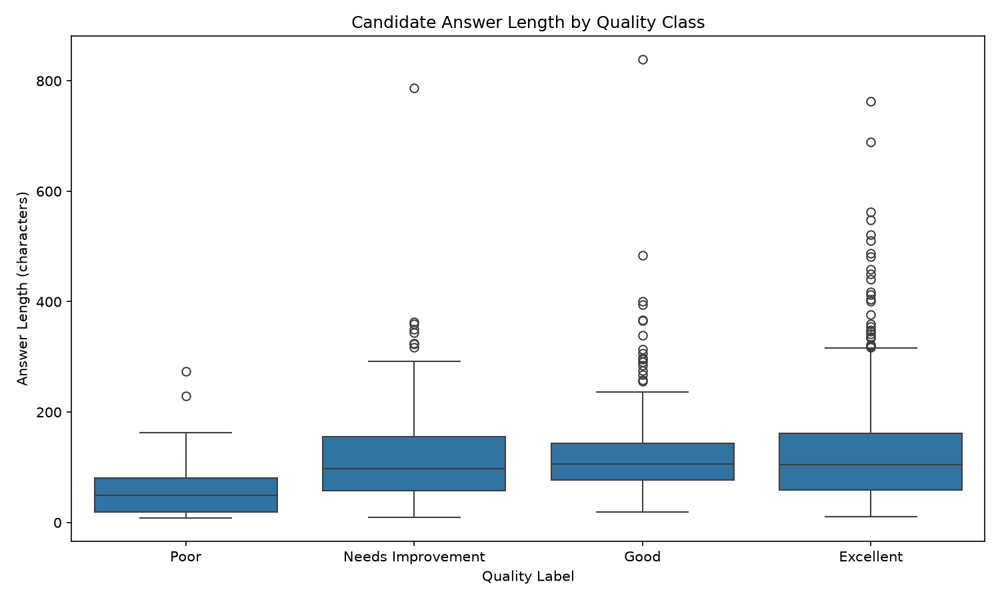

# Phase 1 Report: Baseline Modeling for Short-Answer Grading

**Experiment:** interview-answer-quality-baseline  
**MLflow run IDs (latest FINISHED):** logistic_regression_baseline=`29d2081071294bc1abf26a07ad541d5b`, random_forest=`284e22322f65437f89267b8d2f1fc5f8`, final_test_evaluation=`f885b93e20b946ad8b813040df9d0ff5`

---

## 1. Summary

Random Forest achieves macro-F1 0.3925 on the held-out test set (483 answers, 17 questions), compared to 0.3669 for Logistic Regression. Both models beat the majority-class baseline on macro-F1 (0.1868) but both lose to it on accuracy (0.5963). The macro-F1 difference between models (0.0256) comes mostly from the Poor class (10 test rows, contribution +0.0405); the Good class is the weakest for both models (F1 0.1916 LR, 0.1053 RF). With only 17 test questions and a highly skewed label distribution, the two models are not clearly different.

---

## 2. Dataset and Licence

The dataset is the Mohler Short-Answer Grading (ASAG) corpus, hosted on Hugging Face as `nkazi/MohlerASAG`[^1]. We use the `open_ended` split (2,273 candidate answers across 81 questions) from a single introductory data-structures course at the University of North Texas. The `close_ended` split is not used because its questions have constrained answer formats that differ from the open-ended grading task.

The original paper: Mohler, M., Bunescu, R., & Mihalcea, R. (2011). Learning to Grade Short Answer Questions using Semantic Similarity Measures and Dependency Graph Alignments. *Proceedings of ACL-HLT 2011*.

The dataset is released under CC BY 4.0. This real-world dataset replaces the synthetic data used in early prototyping because it provides authentic student answers with human grader scores.

Faculty notification: Faculty have not yet been informed of the dataset change; this is pending.

[^1]: https://huggingface.co/datasets/nkazi/MohlerASAG

---

## 3. Label Mapping

Labels are derived from the dataset's `score_avg` (mean of two graders, range 0–5) using thresholds from `params.yaml`:

| quality_label (int) | Class name           | score_avg range |
|---------------------|----------------------|-----------------|
| 0                   | Poor                 | [0.0, 2.0)      |
| 1                   | Needs Improvement    | [2.0, 3.5)      |
| 2                   | Good                 | [3.5, 4.5)      |
| 3                   | Excellent            | [4.5, 5.0]      |

Class distribution in the full dataset (2,273 rows):

| Class                | Count | Percentage |
|----------------------|-------|------------|
| Poor                 | 80    | 3.52%      |
| Needs Improvement    | 370   | 16.28%     |
| Good                 | 396   | 17.42%     |
| Excellent            | 1427  | 62.78%     |

---

## 4. Grader Agreement

Agreement between the two human graders (computed on all 2,273 rows):

| Metric                          | Value   |
|---------------------------------|---------|
| Quadratic-weighted kappa        | 0.4875  |
| Percent agreement               | 58.69%  |
| Cohen's kappa                   | 0.2988  |
| Pearson r                       | 0.5832  |

**Note:** 89 rows have an ambiguous grader scale (one grader used 0–5, the other 1–5); these affect the agreement statistics above but do not affect the labels used for modeling, which come from `score_avg` after the dataset's own cleaning.

---

## 5. Splits

Data is split by `question_id` using `GroupShuffleSplit` (test first, then validation) so no question appears in more than one split. Grouped 5-fold CV on train uses `StratifiedGroupKFold`. This prevents leakage: answers to the same question share the reference answer and topical vocabulary, so placing them in both train and test would inflate performance.

| Split  | Rows  | Questions | Poor | Needs Imp. | Good | Excellent |
|--------|-------|-----------|------|------------|------|-----------|
| Train  | 1561  | 56        | 62   | 233        | 277  | 989       |
| Val    | 229   | 8         | 8    | 38         | 33   | 150       |
| Test   | 483   | 17        | 10   | 99         | 86   | 288       |

Cross-split text overlap (lowercased, stripped `candidate_answer`):
- Unique strings shared train & val: 2
- Unique strings shared train & test: 6
- Unique strings shared val & test: 1
- Test rows whose answer text also appears in train: 19

The Poor class has only 10 test rows, making per-class estimates unstable.

---

## 6. Features

Features are fitted on **train only** and applied to val/test:

- **TF-IDF**: 5,000 max features, n-gram range (1,2), English stop words, min_df=2, sublinear_tf=true
- **Length features** (5): character count, token count, sentence count, unique-token ratio, mean word length
- **Reference similarity** (1): cosine similarity between candidate and reference answer TF-IDF vectors
- **Total feature count**: 2,824 (2,818 TF-IDF terms after min_df=2, 5 length features, 1 cosine similarity)

---

## 7. Models

| Model                  | Key hyperparameters (params.yaml and training scripts)                    |
|------------------------|-----------------------------------------------------------|
| Logistic Regression    | C=1.0, solver=lbfgs, max_iter=1000, class_weight=balanced |
| Random Forest          | n_estimators=300, max_depth=None, class_weight=balanced   |

Both use `class_weight="balanced"`. CV uses grouped 5-fold (by `question_id`) on train only, with a fresh feature pipeline per fold.

| Metric                          | Logistic Regression | Random Forest |
|---------------------------------|---------------------|---------------|
| CV f1_macro (mean ± std)        | 0.3717 ± 0.0456     | 0.3690 ± 0.0434 |
| CV accuracy (mean ± std)        | 0.5358 ± 0.0118     | 0.5670 ± 0.0256 |
| Validation f1_macro             | 0.3418              | 0.3778        |
| Validation accuracy             | 0.5153              | 0.5764        |
| Validation majority baseline    | 0.6550 (acc) / 0.1979 (f1_macro) | same |

**Note:** CV f1_macro (~0.37) is close to validation f1_macro (~0.34–0.38); CV accuracy (0.5358 LR, 0.5670 RF) is close to validation accuracy (0.5153 LR, 0.5764 RF). High variance across question groups is indicated by CV f1_macro std (~0.045).

---

## 8. Model Selection

Selection rule (fixed before test, from `params.yaml` and `metrics.json`):

> choose higher grouped-CV f1_macro mean; if gap < max(CV f1_macro stds), tie-break by higher validation f1_macro

Result:
- CV f1_macro gap = |0.3717 − 0.3690| = 0.0027
- max(CV std) = max(0.0456, 0.0434) = 0.0456
- Gap < max_std → tie → tie-break by validation f1_macro
- Random Forest validation f1_macro (0.3778) > Logistic Regression (0.3418)
- **Primary model: Random Forest**

Reason recorded in `metrics.json`: "Tie on CV f1_macro (gap=0.0027 < max_std=0.0456); RandomForest has higher val f1_macro (0.3778 vs 0.3418)"

---

## 9. Test Results

### Overall metrics (test set, 483 rows)

| Model                  | Accuracy | f1_macro | f1_weighted | precision_weighted | recall_weighted |
|------------------------|----------|----------|-------------|--------------------|-----------------|
| Logistic Regression    | 0.5611   | 0.3669   | 0.5577      | 0.5591             | 0.5611          |
| Random Forest          | 0.5901   | 0.3925   | 0.5544      | 0.5333             | 0.5901          |
| Majority baseline      | 0.5963   | 0.1868   | —           | —                  | —               |

*Accuracy and recall_weighted are the same quantity; counted as one.*

### Per-class metrics (test set)

| Class                | Support | LR Precision | LR Recall | LR F1   | RF Precision | RF Recall | RF F1   |
|----------------------|---------|--------------|-----------|---------|--------------|-----------|---------|
| Poor                 | 10      | 0.1200       | 0.3000    | 0.1714  | 0.3750       | 0.3000    | 0.3333  |
| Needs Improvement    | 99      | 0.4079       | 0.3131    | 0.3543  | 0.4231       | 0.3333    | 0.3729  |
| Good                 | 86      | 0.1975       | 0.1860    | 0.1916  | 0.1489       | 0.0814    | 0.1053  |
| Excellent            | 288     | 0.7342       | 0.7674    | 0.7504  | 0.6914       | 0.8403    | 0.7586  |

### Per-class F1 difference (RF − LR) and contribution to macro-F1 difference

| Class                | F1 difference (RF − LR) | Contribution (diff ÷ 4) |
|----------------------|-------------------------|-------------------------|
| Poor                 | +0.1619                 | +0.0405                 |
| Needs Improvement    | +0.0186                 | +0.0046                 |
| Good                 | −0.0864                 | −0.0216                 |
| Excellent            | +0.0082                 | +0.0020                 |
| **Total (macro-F1 diff)** | **+0.1023** (sum of diffs) / 4 = **+0.0256** | |

RF's macro-F1 edge (0.0256) comes mostly from the Poor class (+0.0405 contribution), which has only 10 test rows. The Good class is the weakest for both models and hurts RF more (−0.0216 contribution).

### Figures









The Random Forest confusion matrix is also saved as `figures/confusion_matrix_random_forest.png`; it shows the same model as the primary-model figure.

**Plain conclusion:** Both models beat the majority baseline on macro-F1 (0.3669 and 0.3925 vs 0.1868) but both lose on accuracy (0.5611 and 0.5901 vs 0.5963). The macro-F1 difference is small and driven by a tiny class; the two models are not clearly different.

---

## 10. Data Quality Notes (Limitations)

- **Duplicates in raw data:** 143 rows have a `candidate_answer` that appears more than once (45 unique answers); 98 redundant copies (keep=first). 105 fully duplicated rows (all columns); 68 fully redundant copies. 1 `(question_id, candidate_answer)` group has more than one `quality_label`.
- **Cross-split text overlap:** 19 test rows (3.93%) share answer text with train; 6 unique answer strings overlap train/test. This may inflate test performance slightly.
- Nothing was changed after seeing test results.

---

## 11. Limitations

1. **Single course**: Only one introductory data-structures course (UNT); generalization unknown.
2. **Skewed labels**: Excellent class is 62.8% of data; Poor is 3.5%.
3. **Tiny Poor test class**: Only 10 test rows → unstable per-class estimates.
4. **Few questions**: 8 validation and 17 test questions → validation and test scores are noisy.
5. **Thresholds are a design choice**: The four bins (Poor <2.0, Needs Improvement <3.5, Good <4.5, Excellent ≥4.5) are a design choice, fixed in params.yaml before training.
6. **Moderate grader agreement**: Quadratic-weighted kappa 0.4875; labels have noise.
7. **High variance across questions**: CV f1_macro std ~0.045; only 8 validation and 17 test questions.
8. **Duplicates and cross-split text overlap** (see §10).
9. **DVC remote is local-only**: Data is not on GitHub; fresh clone requires re-downloading from Hugging Face.
10. **Faculty notification**: Faculty have not yet been informed of the dataset change; this is pending.
11. **Logistic Regression convergence**: LogisticRegression did not converge within max_iter=1000 (final fit and all 5 CV folds). The reported metrics are for that unconverged fit; nothing was changed after the test evaluation.
12. **Test coverage**: the 25 unit tests cover splitting and feature building only. Training and evaluation scripts are checked by running the pipeline, not by tests.
13. **MLflow IDs are local**: the run IDs refer to the author's local MLflow store; `mlruns/` is not in git, so teammates get different IDs after `dvc repro`.

## 12. Reproducibility

### Exact commands (Python 3.11, venv)

```bash
python -m venv .venv
source .venv/bin/activate
pip install -r requirements.txt
export MLFLOW_ALLOW_FILE_STORE=true
python src/data/download_mohler.py
dvc repro
python -m pytest -q
```

### Test suite

`python -m pytest -q` → **25 tests passed** (2026-10-15).

### Verified locally

Two consecutive `dvc repro` runs skipped all stages (data and pipelines up to date).

### Fresh-clone reproduction

Reproduced on a fresh clone from GitHub with the local DVC remote removed and the data fetched with `src/data/download_mohler.py`: all stages ran, and CV, validation and test metrics matched to 4 decimals. `pytest-cov` was missing from `requirements.txt` and was added afterwards (25 tests pass). After `dvc repro` on a new machine, `git status` shows modified `mohler.dvc` and `dvc.lock` (the re-downloaded data folder hashes differently); these should not be committed.

### MLflow

- Experiment: `interview-answer-quality-baseline`
- Key runs (latest FINISHED):
  - `logistic_regression_baseline`: `29d2081071294bc1abf26a07ad541d5b`
  - `random_forest`: `284e22322f65437f89267b8d2f1fc5f8`
  - `final_test_evaluation`: `f885b93e20b946ad8b813040df9d0ff5`

---

## 13. Phase 2 Plan

- Sentence-embedding features (e.g., SBERT) to capture semantic similarity beyond TF-IDF.
- Ordinal classification or regression models (score_avg is ordinal 0–5).
- More questions or courses to reduce variance and improve generalization.
- Model serving (FastAPI) and monitoring (drift detection, SLIs).

---

## 14. Commits

```
5f05fb2 Update dvc.lock for PYTHONPATH change in stage commands
fe46e54 Fix PYTHONPATH in dvc.yaml for module imports
9922f4b Fix fsspec version to resolve datasets dependency conflict
6f55df5 Add quick start and Mohler download script for teammates
4665b7d P8: executed notebooks; ignore egg-info
fd70e54 P7: final test evaluation, selection rule, metrics
f0a48ac P6b: random forest comparison, shared model utils, fix pipeline pickling
77ba736 Ignore egg-info
2080263 P6a: logistic regression baseline with MLflow and grouped CV
54d7e01 P5: DVC remote, dataset tracking, lockfile
9ad58d2 P4: feature pipeline and tests
9edbd29 P1-P3: config for Mohler dataset, dataset prep, load, grouped split, tests
113b78b checkpoint 1
a528e44 Checkpoint 1
6559d43 chore: initialize professional MLOps project foundation
e010ff2 Initial commit
```

---

## Commands Run for This Report

```bash
# Data analysis
python3 -c "
import pandas as pd
df = pd.read_parquet('data/raw/interview_data.parquet')
print(f'Total rows: {len(df)}')
print(f'Total unique questions: {df[\"question_id\"].nunique()}')
dup_mask = df.duplicated(subset=['candidate_answer'], keep=False)
print(f'Rows with duplicate candidate_answer (keep=False): {dup_mask.sum()}')
print(f'Unique candidate_answers duplicated: {df[dup_mask][\"candidate_answer\"].nunique()}')
print(f'Redundant copies (keep=first): {df.duplicated(subset=[\"candidate_answer\"], keep=\"first\").sum()}')
full_dup = df.duplicated(keep=False)
print(f'Fully duplicated rows (keep=False): {full_dup.sum()}')
print(f'Fully redundant copies (keep=first): {df.duplicated(keep=\"first\").sum()}')
grouped = df.groupby(['question_id', 'candidate_answer'])['quality_label'].nunique()
print(f'(q_id, cand_ans) groups with >1 quality_label: {(grouped > 1).sum()}')
print(df['quality_label'].value_counts().sort_index())
"

python3 -c "
import pandas as pd
train = pd.read_parquet('data/processed/train.parquet')
val = pd.read_parquet('data/processed/val.parquet')
test = pd.read_parquet('data/processed/test.parquet')
train_ans = train['candidate_answer'].str.lower().str.strip()
val_ans = val['candidate_answer'].str.lower().str.strip()
test_ans = test['candidate_answer'].str.lower().str.strip()
train_set = set(train_ans.unique())
val_set = set(val_ans.unique())
test_set = set(test_ans.unique())
print(f'Train unique answers: {len(train_set)}')
print(f'Val unique answers: {len(val_set)}')
print(f'Test unique answers: {len(test_set)}')
print(f'Shared train&val: {len(train_set & val_set)}')
print(f'Shared train&test: {len(train_set & test_set)}')
print(f'Shared val&test: {len(val_set & test_set)}')
print(f'Test rows in train: {test_ans.isin(train_set).sum()}')
print('Test class dist:'); print(test['quality_label'].value_counts().sort_index())
print('Val class dist:'); print(val['quality_label'].value_counts().sort_index())
print('Train class dist:'); print(train['quality_label'].value_counts().sort_index())
"

python3 -c "
import json
with open('reports/metrics.json') as f: m = json.load(f)
lr = m['test_evaluation']['logistic_regression']['per_class_metrics']
rf = m['test_evaluation']['random_forest']['per_class_metrics']
for c in lr:
    diff = rf[c]['f1'] - lr[c]['f1']
    print(f'{c}: diff={diff:.4f}, contrib={diff/4:.4f}')
print(f'LR macro-F1: {m[\"test_evaluation\"][\"logistic_regression\"][\"test_metrics\"][\"f1_macro\"]:.4f}')
print(f'RF macro-F1: {m[\"test_evaluation\"][\"random_forest\"][\"test_metrics\"][\"f1_macro\"]:.4f}')
print(f'CV LR: {m[\"selection\"][\"cv_metrics\"][\"logistic_regression\"][\"cv_f1_macro_mean\"]:.4f} ± {m[\"selection\"][\"cv_metrics\"][\"logistic_regression\"][\"cv_f1_macro_std\"]:.4f}')
print(f'CV RF: {m[\"selection\"][\"cv_metrics\"][\"random_forest\"][\"cv_f1_macro_mean\"]:.4f} ± {m[\"selection\"][\"cv_metrics\"][\"random_forest\"][\"cv_f1_macro_std\"]:.4f}')
print(f'Val LR: {m[\"selection\"][\"validation_f1_macro\"][\"logistic_regression\"]:.4f}')
print(f'Val RF: {m[\"selection\"][\"validation_f1_macro\"][\"random_forest\"]:.4f}')
"

export MLFLOW_ALLOW_FILE_STORE=true
python3 -c "
import mlflow
mlflow.set_tracking_uri('file:./mlruns')
exp = mlflow.get_experiment_by_name('interview-answer-quality-baseline')
runs = mlflow.search_runs(experiment_ids=[exp.experiment_id], order_by=['start_time DESC'])
for _, r in runs.iterrows():
    if r['status'] == 'FINISHED':
        name = r.get('tags.mlflow.runName', 'N/A')
        print(f'{name}: {r[\"run_id\"]}')
        break
"

python -m pytest -q
dvc repro
dvc repro
git log --oneline
```

---
